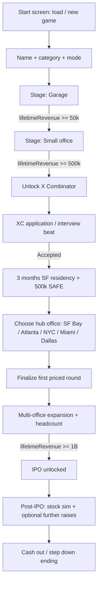

# Startup Simulator — Game Design & Engineering Plan

> **Internal planning document.** Not linked from the public site, RSS, or sitemap. Source of truth for implementation phases until the game ships.

## Working title & slug

- **Title:** Startup Simulator (working name; can rebrand later)
- **Repo path:** `work/startup-sim/`
- **Site route:** `/work/startup-sim/` → iframe `/play/startup-sim/index.html`
- **Stack:** Vanilla JS (ES modules), HTML, CSS — same pattern as HOS and EER

---

## Vision

A single-player startup tycoon with a **12-month calendar loop**, **revenue-driven progression**, **fundraising & cap table**, **department headcount planning** (not a deep HR directory), **AI-generated news & social feeds**, and a **context-aware chief-of-staff chatbot**. Tone: aspirational but grounded; satire optional in news/social, not in core finance math.

**Win condition:** Reach **$1B cumulative revenue** to unlock IPO; optionally continue post-IPO to grow stock price or **cash out** (CEO steps down, final payout = shares × price).

**Modes:**

| Mode | Starting cash | Difficulty | Story |
|------|---------------|------------|--------|
| **Career** | $120,000 | Standard costs, market friction, event severity | Full narrative beats |
| **Sandbox** | $500,000 default; dropdown up to **$1B** | Lower friction (cheaper research, milder penalties) | Same story beats and revenue gates |

**Important:** Sandbox starting cash does **not** count toward **revenue earned** milestones. Both modes track `lifetimeRevenue` from $0.

---

## Player journey (progression gates)

All gates use **lifetime revenue earned** (not cash on hand, not funding).



### Stage: Garage

- Visual: small garage (CC0 / Commons art — see Assets)
- **Monthly action budget:** 4 counted tasks (see Calendar)
- **Staff:** Solo founder; after unlock, department headcount capped at **2 total** (any mix of remote roles) until office stage
- Activities: research product, develop MVP/features, marketing, sales/support tasks tuned to category (SaaS, marketplace, consumer app, etc.)

### Stage: Small office ($50k revenue)

- Better research tree depth, more marketing channels, higher revenue multipliers
- **Monthly tasks:** 5–6
- In-person + remote hiring opens; department budgets become relevant

### Stage: X Combinator ($500k revenue)

- Fictional **X Combinator (XC)** — YC-like accelerator, not using YC trademarks in UI copy where avoidable
- Relocate to SF for **3 in-game months** (calendar continues; tasks may be XC-themed)
- **Application:** **scripted interview questions** (fixed prompts in data); player types short answers; **AI scores** responses for accept/reject/waitlist — scoring is **lenient** (this is a game, not real YC). Fallback: pass if API offline.
- On acceptance: **+$500,000** on a **SAFE** (see Finance for dilution)
- Unlocks **fundraising flow** (term sheet, valuation, dilution)

### Stage: Post-XC hub + raise

- Player picks permanent hub: **Bay Area, Atlanta, NYC, Miami, Dallas** (each with cost-of-living, talent pool, and market modifiers)
- **First priced round** finalized here; valuation sets ceiling for growth mechanics
- **Free-buy satellite offices** to increase headcount caps (spreadsheet-style rows: location, seats, monthly burn)

### Stage: IPO ($1B revenue)

- IPO window opens; timing matters (market sentiment from news layer, metrics thresholds)
- Post-IPO: **stock price** simulation on **monthly ticks only** (no day-level sim anywhere in the game), secondary raises, founder stake value
- **End game:** Cash out → AI news article + summary screen (shares × price, rank, equity retained)

---

## Startup categories

Player picks one at new game (affects research tree labels, task templates, unit economics defaults — not different code paths per category if data-driven).

Initial category list (expand via JSON data):

- B2B SaaS
- Consumer social
- Marketplace / gig (Uber-like)
- Delivery / logistics (Instacart-like)
- Fintech
- AI tools
- Hardware + software
- Healthtech
- Climate / energy
- Gaming / media

Each category defines: `defaultACV`, `salesCycleWeeks`, `viralityCoeff`, `regulatoryRisk`, `featureThemes[]`.

---

## Core loops

### 1. Calendar (12-month year, repeatable)

- Time unit: **Month** (display as `Month M, Year Y` — Year 1 starts at incorporation)
- Each month:
  1. Player receives **4–8 counted tasks** (capacity by stage; garage = 4)
  2. Player completes tasks (marketing campaign, product sprint, partnership, etc.)
  3. **Staff/finance/admin** actions do **not** consume task slots (adjusting draft headcount, finalize staffing, cap table view, raises)
  4. End month → resolve: revenue, burn, payroll, random events, **AI news batch**, social feed tick, chief-of-staff digest optional
- Years roll indefinitely until win/exit; difficulty and story beats can reference real-world **fictional timeline** (see News)

### 2. Finance

State fields (minimum):

- `cash`, `monthlyBurn`, `lifetimeRevenue`, `mrr` / `arr` (category-dependent)
- `valuation`, `lastRound`, `instruments[]`
- **Cap table:** `{ holderId, name, shares, class, dilutedPct }` — founder starts 100% on 10M authorized (numbers tunable)

**Funding & dilution (locked defaults — industry-average, tuned for fun):**

| Event | Cash in | Instrument | Founder dilution (typical) |
|-------|---------|------------|----------------------------|
| **XC acceptance** | +$500k | SAFE, **$8M cap**, **20% discount** | **~6%** when SAFE converts (game shows “~6% on conversion”) |
| **First priced round** (post-XC) | Player-driven | **Seed** at **$12M pre** / **$15M post** on **$3M** raised | **~20%** new pool to investors |
| **Series A** (optional later) | Player-driven | **$40M pre** / **$50M post** on **$10M** raised | **~20%** |
| **Series B** (optional later) | Player-driven | **$120M pre** / **$150M post** on **$30M** raised | **~20%** |

- **Option pool:** seed round adds **10%** ESOP (dilutes everyone pro-rata on cap table UI).
- **Raises after first close:** optional any time; bad timing (low revenue growth, negative news) applies **10–25% valuation haircut** on the template above.
- **Dilution:** each round issues new shares; **pro-forma cap table** before confirm; founder starts **10M shares / 100%**.

**Revenue:**

- Task outcomes + **finalized** department headcount + product level + marketing spend → monthly revenue delta
- Sandbox: multiply positive outcomes / reduce failure severity (config flags)

### 3. Staff management (department headcount table)

**Not** an in-depth staff directory — no per-person roster, names, or HR profiles.

**UX:**

- Single table: one row per **department** with columns such as **Department**, **Headcount** (stepper or numeric input), **$/head/mo** (read-only avg from stage + hub), **Subtotal/mo**.
- Departments: **Engineering**, **Product**, **Sales**, **Marketing**, **Finance/G&A**, **Support** (Support unlocks after office stage).
- Player adjusts counts in a **draft** state; a live summary panel shows:
  - **Total payroll/mo** (sum of subtotals)
  - **Projected burn** (payroll + fixed office/infra costs)
  - **Projected surplus/deficit** vs expected revenue (use last month revenue or simple forecast — label clearly)
- **Finalize staffing** commits draft → `staff.headcountByDept` for the month; until finalized, month-end payroll uses **last finalized** counts.
- **Garage:** max **2** total headcount across all departments (founder not counted).
- **Office+:** caps rise by stage and satellite offices (seat limits, not named employees).
- **Layoffs:** reducing headcount on finalize with a net decrease vs prior month may trigger **negative AI news** if drop ≥ **15%** of total headcount.

**Simulation:** Revenue and task effectiveness use department counts (e.g. marketing → campaign yield, engineering → feature velocity) — no individual productivity rolls.

### 4. Counted monthly tasks

Task types (data-driven `TaskDefinition`):

- Run marketing campaign (channel pick)
- Ship feature (from research queue)
- Research node unlock
- Sales push / enterprise deal attempt
- Partnership / BD
- Fundraising prep (post-XC unlock)
- XC-specific tasks during residency

Each task: `{ id, title, description, duration: 'month', cost, outcomes: { revenue, product, buzz, risk } }` with RNG bands.

---

## Social media (LinkedIn + X clones)

Two tabs inside **Social** panel — visually distinct but structurally shared:

| Surface | UX cues |
|---------|---------|
| **ProNet** (LinkedIn-like) | Blue-gray, long-form posts, reactions, comment threads, “professional” tone |
| **Chirp** (X-like) | Short posts, reposts, likes, tighter character limit |

**Player:** compose post (text + optional “announcement” template).

**AI:**

- On month advance and on player post: generate NPC comments, likes, reposts from seeded personas (investors, competitors, employees, randos)
- Personas stored in save; relationship scores affect tone
- Rate-limited via same narrative API as other games

**Persistence:** last 90 days of posts in save; older archived in `socialArchive[]` (optional view).

---

## AI news

- **Tab: World & Tech News** — 3–4 articles max per month after month-end
- Replace prior month’s feed on advance (archive accessible in **News Archive** subview)
- Mix:
  - **Industry react** to player (funding, layoffs, launches, scandals)
  - **Global fictional timeline** (e.g. *Artemis IV lands June 2028*) — seeded timeline JSON + AI fill-in
  - **Macro** (rates, AI regulation) affecting modifiers lightly
- **Names:** Prefer **fictional and parody** outlets/companies/people (e.g. “Macrohard”, “Blue Origin of the Bay”, “The Financier Times”) — avoid real trademarks and real exec names where possible; AI prompts enforce this.

**API kind:** `startup_news_month` → returns `{ articles: [{ headline, dek, body, source, date }] }`

---

## Chief of staff (AI chatbot)

- Docked panel or modal: chat UI
- System context bundle each request:
  - Stage, cash, burn, runway, revenue, cap table summary, active tasks, recent news headlines, **department headcounts**
- **kind:** `startup_advisor_chat` (multi-turn: client sends last N turns + snapshot)
- Guardrails: no real financial advice disclaimer in footer; suggest in-game actions only
- Fallback: scripted tips if API offline

---

## AI infrastructure

**Use the existing HOS narrative Lambda — no new stack for Phase 4.**

The deployed endpoint behind `HOS_NARRATIVE_API_URL` / `infra/lambda/hos-narrative` already accepts `{ kind, context }` and calls OpenAI. Startup Simulator adds **new `kind` branches** in `buildPrompt()` / response parsing in that same Lambda (alongside HOS and EER kinds). Same Secrets Manager key, same `OPENAI_MODEL`, same CORS/rate limits.

| kind | Purpose |
|------|---------|
| `startup_news_month` | Monthly articles (JSON array) |
| `startup_social_reactions` | Comments on player posts |
| `startup_xc_interview_score` | Score scripted XC answers → `{ accepted, feedback, score }` — **permissive rubric** |
| `startup_advisor_chat` | Chief of staff (multi-turn in client, single completion per message) |
| `startup_ipo_press` | IPO / step-down story |

**When to wire:**

- **Phase 1–3:** No Lambda required (offline fallbacks for XC: auto-accept or simple keyword pass).
- **Phase 4:** Extend **`hos-narrative` Lambda** + point Startup Sim client at the **same URL** as HOS (inject via shared config or duplicate `narrative-api.json` URL at build). Optional: add `/play/startup-sim/narrate` rewrite on the static host if we mirror HOS’s same-origin proxy — not a second Lambda.

**Model:** Same as other games (`OPENAI_MODEL`, default **`gpt-5-mini`** / project “5.4 mini” naming).

**Client:** `modules/NarrativeApi.js` — same POST shape as HOS `NarrativeApi.js`.

**Rate limits:** existing IP bucket; advisor chat capped ~**10/min** per client IP in Lambda if needed.

---

## Assets (Commons-first)

No placeholder “slop” art in production builds. Track provenance in `work/startup-sim/ASSETS.md`.

**Sources:**

- [Kenney.nl](https://kenney.nl) (CC0 UI/icons)
- [OpenGameArt.org](https://opengameart.org) (check per-asset license)
- [Wikimedia Commons](https://commons.wikimedia.org) (buildings, cities, logos-free photos)
- [Poly Haven](https://polyhaven.com) if 3D ever needed (CC0)
- [Google Material Symbols](https://fonts.google.com/icons) / Phosphor (icon fonts, acceptable licenses)

**Needs:**

- Garage interior / exterior
- Small office
- City skylines (5 hubs)
- UI chrome (desks, charts)
- Avatar silhouettes for social

**Pipeline:**

1. Curate asset manifest JSON (`assets/manifest.json`) with `{ id, path, license, author, url }`
2. Build script validates manifest present for release
3. Optimize PNG/WebP in repo under `work/startup-sim/assets/`

---

## UI / screens

1. **Start:** New / Load / Settings (API status)
2. **Setup:** Mode, sandbox cash dropdown, company name, category
3. **Main shell:** Top bar (month, cash, revenue, runway) + tabs:
   - **Desk** (tasks + quick actions)
   - **Product** (research / dev queue)
   - **Growth** (marketing & sales)
   - **People** (department headcount + finalize staffing)
   - **Finance** (burn, cap table, raise flow)
   - **Social** (ProNet + Chirp)
   - **News**
   - **Advisor** (chat)
4. **Modals:** Raise wizard, XC application, IPO, month-end summary
5. **End:** Step-down summary + shareable stats

---

## Data & modules (proposed)

```
work/startup-sim/
  index.html
  style.css
  game.js                 # bootstrap, routing, month loop
  narrative-api.json      # injected URL (build)
  modules/
    startup-config.js     # injected constants
    GameState.js          # authoritative state + reducers
    Calendar.js             # month advance, task slots
    Progression.js          # stage gates
    Finance.js              # cash, revenue, cap table, rounds
    Staff.js                # headcount draft, finalize, payroll projection
    Tasks.js                # task deck + resolution
    Categories.js           # startup type data
    Social.js               # feeds + post composer
    News.js                 # archive + display
    NarrativeApi.js         # AI client
    Advisor.js              # chat UI + context builder
    Storage.js              # localStorage saves
    UI.js                   # DOM
    utils.js
  data/
    categories.json
    tasks.json
    research-trees/
    news-timeline-seed.json
    personas.json
```

---

## Save format

- `version`, `mode`, `sandboxStartingCash`, `company`, `calendar`, `finance`, `staff: { headcountByDept, draftHeadcountByDept, lastFinalizedMonth }`, `product`, `social`, `newsArchive`, `flags` (xcAccepted, ipoCompleted, etc.)
- Migrate on version bump

---

## Implementation phases

### Phase 0 — Scaffold (this PR)

- [x] Plan document
- [x] WIP registry + play route + copy-work
- [x] Start screen shell + module graph (Calendar, Progression, Finance, Staff, Tasks, Social, News, Advisor, Storage, utils)
- [x] Data stubs (`categories.json`, `tasks.json`, `news-timeline-seed.json`, `personas.json`)
- [x] Main shell tabs (Desk → Advisor) with Phase placeholders + save/load
- [x] ASSETS.md + empty manifest
- [x] Shared narrative URL inject (same Lambda as HOS/EER)

### Phase 1 — Core sim (no AI)

- [x] GameState v2, calendar, 4 garage tasks (6 in office), basic revenue/burn
- [x] Garage → office gate at $50k (fixed costs + task slots)
- [x] Save/load (includes month tasks + log)
- [x] Category picker affects revenue/cost multipliers
- [x] Game over on negative cash after month close

### Phase 2 — Staff & finance depth

- [x] Department headcount table with steppers, draft vs finalize, surplus/deficit vs last month revenue
- [x] Month-end payroll uses finalized headcount; staff boosts task revenue
- [x] Cap table UI + XC SAFE ($500k, ~6%) + seed close ($3M @ $15M post, ESOP 10%)
- [x] $500k lifetime revenue unlocks XC (Finance tab)
- [x] Layoffs ≥15% queued for Phase 4 news

### Phase 3 — Progression & cities

- [x] XC apply flow: scripted interview (`data/xc-interview.json`) + Lambda **`startup_xc_interview_score`** (lenient offline fallback)
- [x] 3-month SF residency counter; hub pick (Bay, NYC, Miami, Dallas, Atlanta) with econ modifiers
- [x] Satellite offices (free-buy seats + rent); seed requires batch + hub
- [x] XC / post-XC task deck + stage task slots (6 / 7)

### Phase 4 — AI layer

- [x] Lambda kinds: `startup_news_month`, `startup_social_reactions`, `startup_advisor_chat` (+ XC score)
- [x] News tab: 3–4 articles on month close, archive toggle, offline parody fallback
- [x] Social: ProNet + Chirp compose, AI/offline reactions, persona seeds
- [x] Advisor: context-aware chat with offline tips fallback
- [x] Save v5 (`advisor`, social archive, news archive)

### Phase 5 — IPO & endgame

- [x] $1B lifetime revenue gate → **File IPO** on Finance (requires closed seed)
- [x] Post-listing **monthly stock ticks** (MRR growth, runway, news sentiment, noise)
- [x] **Step down & cash out** ending + stats screen (founder stake × share price)
- [x] Lambda **`startup_ipo_press`** + offline headline fallback
- [x] Late-game tasks + post-seed **scaling revenue mult** (sandbox +20%)
- [x] Save **v6** (`publicMarket`, `ending`, IPO flags)

### Phase 6 — Polish

- Commons assets wired per manifest
- Accessibility, mobile layout, tutorials
- Status **live** on work index

---

## Decisions (locked)

1. **XC interview:** **Scripted questions** in game data; **AI scores** free-text answers. Rubric is **forgiving** (clear pass band, flavor feedback) — entertainment first, not YC simulation.
2. **Dilution defaults:** See **Funding & dilution** table above (XC SAFE ~6%, seed/A/B ~20% with stated pre/post templates + 10% ESOP at seed).
3. **Stock sim:** **Monthly ticks only** — aligned with calendar; no day progression anywhere.
4. **News & social names:** **Parody/fictional** by default; prompt guardrails + seeded persona names — no real companies or living public figures.
5. **Multiplayer / leaderboards:** **Out of scope.**

---

## Success metrics (dev)

- Playable garage → office loop without AI
- One full career path to IPO in under ~2 hours (target)
- API costs bounded (monthly batch + chat limits)
- Lighthouse reasonable for static shell

---

## References in repo

- HOS: week loop, `NarrativeApi.js`, Lambda `hos-narrative`
- EER: meter consequences, AI inbox JSON shape
- Deploy: `docs/hos-openai-aws.md`, `scripts/inject-hos-config.mjs` (pattern for startup-sim inject)
